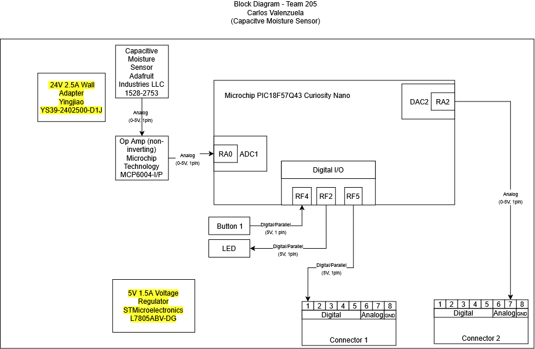

## Overview
This block diagram illustrates the moisture sensor subsystem of Team BAMF's plant monitoring system. It uses a moisture sensor to determine whether the plant is receiving enough water. The system then communicates with a teammate's board to transmit sensor readings and activate a water pump.

The block diagram shows the wiring connections between the components and the microcontroller, as well as the microcontroller's peripherals. It documents the essential system details needed for communication, understanding, and replication.

## Block Diagram 

