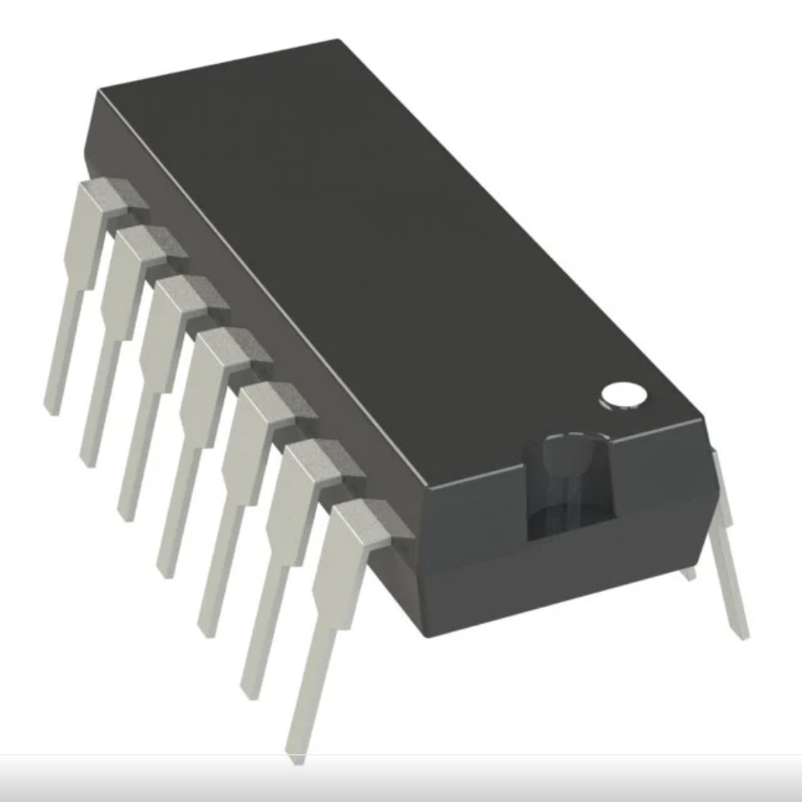
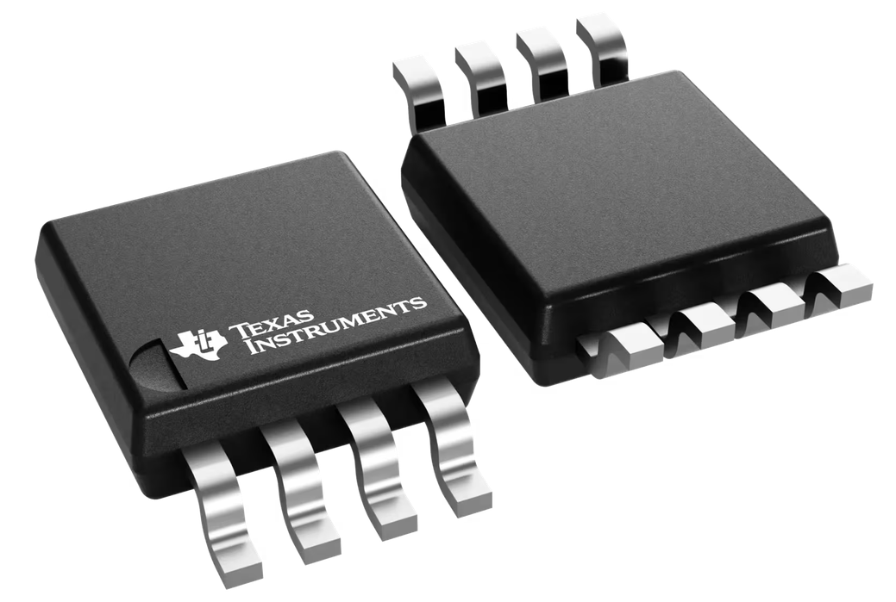
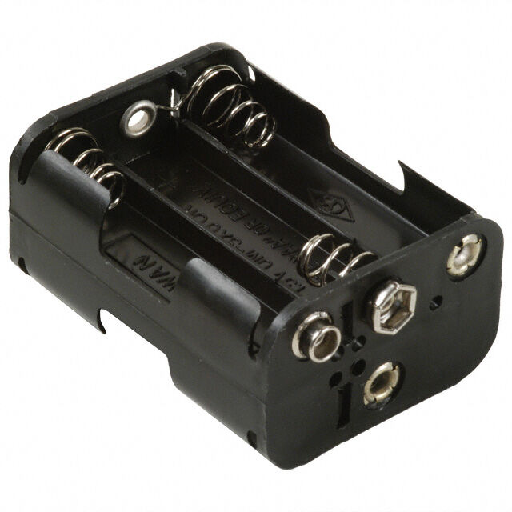

**Moisture Sensor**

| **Solution**                                                                                                                                                                                      | **Pros**                                                                                                                                    | **Cons**                                                                                            |
| ------------------------------------------------------------------------------------------------------------------------------------------------------------------------------------------------- | ------------------------------------------------------------------------------------------------------------------------------------------- | --------------------------------------------------------------------------------------------------- |
|  Option 1.  4411-ST0160-ND CAPACITIVE SOIL MOISTURE SENSOR $1.89/each [link to product](https://www.digikey.com/en/products/detail/sunfounder/ST0160/22116813)                 | \* Inexpensive \* Analog voltage output \* Great corrosion resistance                                               | \*  Temperature sensitivity \* Slow response to rapid moisture changes  |
|  \* Option 2.  \* 1528-2753-ND STEMMA SOIL SENSOR - I2C CAPACIT  \* $1/each  \* [Link to product](https://www.digikey.com/en/products/detail/adafruit-industries-llc/4026/9745252) | \* Uses I²C communication  \* Great corrosion resistance   \* Built in temperature sensor for calibration | * More expensive                                                          |

**Choice:** 4411-ST0160-ND CAPACITIVE SOIL MOISTURE SENSOR

**Rationale:** The 4411-ST0160-ND capacitive soil moisture sensor provides excellent corrosion resistance, is relatively inexpensive when purchased from the correct retailer, and outputs the analog signal required for my analog circuit.

**Op Amp**

| **Solution**                                                                                                                                                                                      | **Pros**                                                                                                                                    | **Cons**                                                                                            |
| ------------------------------------------------------------------------------------------------------------------------------------------------------------------------------------------------- | ------------------------------------------------------------------------------------------------------------------------------------------- | --------------------------------------------------------------------------------------------------- |
|  Option 1.  MCP6004 Op-Amp  $0.60/each [link to product](https://www.digikey.com/en/products/detail/microchip-technology/MCP6004-I-P/523060)                 | \* Low power consumption per amp 100uA     \* Easy mounting  \* Four op amp systems in one                                               | \*  1.8-6V limited supply range \* Lower bandwidth of 1MHz \*Low slew rate of 0.6 V/us |
|  \* Option 2.  \* LM358B Op-Amp  \* $0.59/each  \* [Link to product](https://www.ti.com/product/LM358B#order-quality) | \* Higher bandwith of 1.2 MHz  \* Wide supply range of 3-36v   \* EMI and RF filtering | * Uses more power per amp 300 uA \* Two op amp system                                                          |

**Choice:** MCP6004 Op-Amp

**Rationale:** The MCP6004 op-amp is a component I am already familiar with and provides reliable readings. It also meets the requirements of my 5-volt circuit.

**Power supply**

| **Solution**                                                                                                                                                                                      | **Pros**                                                                                                                                    | **Cons**                                                                                            |
| ------------------------------------------------------------------------------------------------------------------------------------------------------------------------------------------------- | ------------------------------------------------------------------------------------------------------------------------------------------- | --------------------------------------------------------------------------------------------------- |
|  Option 1.  YS39-2402500-D1J AC to DC Wall Adapter  $0.60/each [link to product](https://www.jameco.com/z/YS39-2402500-D1J-Yingjiao-Switching-AC-DC-Wall-Adapter-24-VDC-2-5A-2-1mm-DC-Plug_2734919.html)                 | \* Low power consumption per amp 100uA     \* Easy mounting  \* Four op amp systems in one                                               | \*  1.8-6V limited supply range \* Lower bandwidth of 1MHz \*Low slew rate of 0.6 V/us |
|  \* Option 2.  \* LM358B Op-Amp  \* $0.59/each  \* [Link to product](https://www.ti.com/product/LM358B#order-quality) | \* Higher bandwith of 1.2 MHz  \* Wide supply range of 3-36v   \* EMI and RF filtering | * Uses more power per amp 300 uA \* Two op amp system                                                          |

**Choice:** MCP6004 Op-Amp

**Rationale:** The MCP6004 op-amp is a component I am already familiar with and provides reliable readings. It also meets the requirements of my 5-volt circuit.

