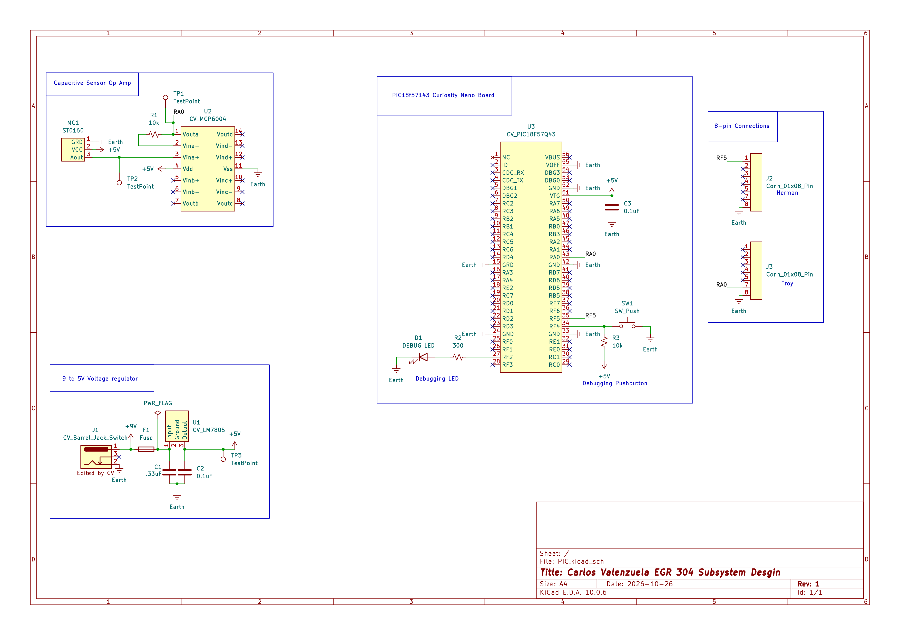

## Overview

This schematic is designed for Team BAMF's plant monitoring system. It incorporates a soil moisture sensor circuit to measure soil moisture and determine whether the plant needs water.

The system measures changes in the sensor's electrical properties caused by the soil's moisture content. The sensor produces an analog signal that is processed by the Nano microcontroller using its analog-to-digital converter (ADC). The microcontroller then uses the sensor readings to send data to a display on one board and control a solenoid on another board.

{style width:"350" height:"300;"}
**Figure ##:** Team BAMF Light Sensor schematic..

## Resouces

The schematic as a PDF download is available [*here*](ExampleSchematic.pdf), and the Zip folder of the project [*here*](PIC.7z).
